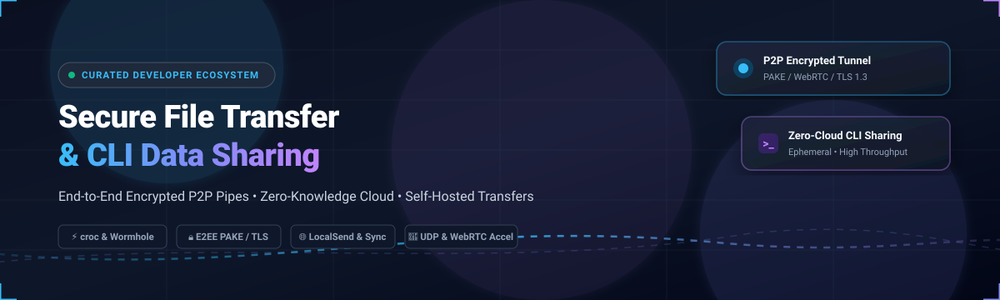

# 🔐 Awesome-Secure-File-Transfer-CLI-Data-Sharing 🚀

  

 

**A comprehensive, SEO-optimized directory of end-to-end encrypted (E2EE) file transfer SaaS platforms, peer-to-peer (P2P) CLI utilities, ephemeral self-hosted sharing servers, and cross-platform data-sharing protocols.**

---

## 📑 Table of Contents
- [📌 Sector Overview & Market Dynamics](#-sector-overview--market-dynamics)
- [🏢 SaaS & Hosted Platforms](#-saas--hosted-platforms)
- [💻 Open-Source GitHub Projects](#-open-source-github-projects)
- [🛠️ Architectural Patterns & Best Practices](#️-architectural-patterns--best-practices)
- [🤝 How to Contribute](#-how-to-contribute)
- [⚖️ Disclaimer](#️-disclaimer)

---

## 📌 Sector Overview & Market Dynamics

The global secure file transfer and enterprise Managed File Transfer (MFT) market is estimated at **$2.1 billion in 2026** (projected to reach over **$3.8 billion by 2031** at an ~11.5% CAGR), driven by heightened data privacy mandates (GDPR, HIPAA, NIS2, ISO 27001), ransomware defense requirements, and sprawling hybrid-remote engineering workforces. 

The sector is **moderately fragmented**: enterprise-grade compliance and cloud document orchestration are led by multi-billion dollar titans like **Dropbox**, **Box**, and **Infomaniak**, while high-velocity ad-hoc large file sharing, media transfers, and developer workflows foster intense competition among specialized SaaS providers (**WeTransfer**, **Filemail**, **Smash**, **TransferNow**) alongside rapidly proliferating zero-knowledge, peer-to-peer (P2P), and self-hosted open-source tooling.

---

## 🏢 SaaS & Hosted Platforms

Below is a curated comparison of leading SaaS and hosted secure file transfer platforms, ranked in descending order by company scale (valuation / annual revenue), complete with exact starting tier pricing and specific free-tier / free-trial quotas.

| Platform | Scale (Valuation / Revenue) | Starting Price (Paid Tier) | Free Tier Limits / Free Trial Quota | Core Highlights & Encryption |
| :--- | :--- | :--- | :--- | :--- |
| **[Dropbox Transfer](https://dropbox.com)** | **$8.9B Market Cap** (~$2.5B ARR) | **$11.99 / user / month** (Plus plan, billed annually) | **2 GB limit** on Dropbox Basic Free Forever plan; transfers up to 100 MB per transfer | Enterprise cloud ecosystem, link expiration, password access, download notifications, and AES-256 at rest. |
| **[Box File Transfer / Shield](https://box.com)** | **$4.8B Market Cap** (~$1.1B ARR) | **$15.00 / user / month** (Business plan, 3-user min, billed annually) | **10 GB storage free forever** with a strict **250 MB max per-file upload limit**; 14-day free trial on paid plans | Enterprise-grade governance, granular Zero Trust permissions, vector watermarking, and Box Shield threat auditing. |
| **[WeTransfer](https://wetransfer.com)** | **~$710M Valuation** (Acquired by Bending Spoons) | **$12.00 / user / month** (Pro plan, billed annually) | **Free Forever**: up to **3 GB per transfer** without account; transfers expire after 7 days | Global standard for creative file handoffs, customizable recipient download portals, tracking receipts, and auto-delete. |
| **[Tresorit Send](https://tresorit.com)** | **~$150M Valuation** (Acquired by Swiss Post) | **$13.50 / user / month** (Personal plan, billed annually) | **14-day free trial** of Business plan; free tier offers up to **5 GB per transfer** with max 10 downloads | Zero-knowledge client-side E2EE, Swiss/EU data sovereignty, revocation of download links, and access password enforcement. |
| **[SwissTransfer](https://swisstransfer.com)** | **~$60M ARR** (Division of Infomaniak) | **$0.00 / month** (100% free hosted service subsidized by Infomaniak ecosystem) | **Free Forever**: up to **50 GB per transfer**, 500 transfers/day, up to 30 days retention | Hosted exclusively in Swiss carbon-neutral data centers, no user registration required, password protection, and download limits. |
| **[Send Anywhere](https://send-anywhere.com)** | **~$35M Valuation** (Acquired by Rakuten Symphony) | **$5.99 / user / month** (Sendy PRO) | **Free Forever**: up to **10 GB per link transfer**; unlimited direct 6-digit P2P transfers under 10-minute expiry | Instant direct device-to-device transfers via 6-digit security keys, Chrome/Outlook extensions, and WebRTC fallback. |
| **[Filemail](https://filemail.com)** | **~$12M ARR** | **$12.00 / user / month** (Pro plan, 1 TB storage, billed annually) | **Free Forever**: up to **5 GB per transfer**, maximum 2 transfers per day with 7 days file availability | High-speed UDP-accelerated file transfer protocols, recipient download receipts, dedicated CLI client, and virus scanning. |
| **[Smash](https://fromsmash.com)** | **~$8M ARR** | **$4.80 / user / month** (Pro plan, billed annually) | **Free Forever**: **no strict file size limit** (files >2 GB get non-priority processing); 7-day retention limit | Full download page branding, custom URLs, embedded link previews, password protection, and European/US regional servers. |
| **[TransferNow](https://transfernow.net)** | **~$6M ARR** | **$10.00 / user / month** (Premium plan, billed annually) | **Free Forever**: up to **5 GB per transfer**, up to 5 transfers per day, files retained for 7 days | Password-protected transfers, integrated virus scanning, multi-language support, custom branding, and EU-hosted infrastructure. |
| **[Wormhole](https://wormhole.app)** | **Seed-stage** (~$3M Funding) | **$0.00 / month** (Free tier supported by browser streaming infrastructure) | **Free Forever**: up to **10 GB per transfer** (files <5 GB stored for 24h, files 5–10 GB streamed P2P in real-time) | Zero-knowledge browser file sharing, client-side WebCrypto AES-GCM encryption, ephemeral peer-to-peer WebRTC streaming. |

---

## 💻 Open-Source GitHub Projects

Curated list of production-ready open-source command-line utilities, self-hosted web servers, and peer-to-peer protocols. Sorted in descending order by GitHub stargazers count with official stargazers badges (`style=social`, `color=white`).

| Repository & Tool | Stars Badge | Language / Stack | Primary Focus & Transfer Protocol |
| :--- | :--- | :--- | :--- |
| **[LocalSend](https://github.com/localsend/localsend)** |  | Flutter / Dart | Open-source AirDrop alternative for cross-platform LAN/Wi-Fi transfers using HTTPS/REST with no internet connection required. |
| **[Syncthing](https://github.com/syncthing/syncthing)** |  | Go | Decentralized, bi-directional, continuous file synchronization across private nodes over encrypted TLS with NAT discovery/relays. |
| **[rclone](https://github.com/rclone/rclone)** |  | Go | The command-line "rsync for cloud storage" featuring built-in transparent cryptographic encryption (`crypt`) and ad-hoc HTTP/WebDAV/SFTP servers. |
| **[croc](https://github.com/schollz/croc)** |  | Go | Ultra-fast CLI file transfer between any two machines using PAKE (Password-Authenticated Key Exchange), relay-assisted NAT traversal, and parallel multiplexing. |
| **[Tailscale (Taildrop)](https://github.com/tailscale/tailscale)** |  | Go | WireGuard mesh networking platform with built-in zero-config terminal-to-device file transfer capability (`tailscale file cp`). |
| **[age](https://github.com/FiloSottile/age)** |  | Go | Simple, modern, secure file encryption tool, format, and Go library featuring small explicit keys, UNIX composability, and no config options. |
| **[Magic Wormhole](https://github.com/magic-wormhole/magic-wormhole)** |  | Python | Pioneering CLI utility for securely sending files, text, and directories from one terminal to another via human-pronounceable one-time passcodes. |
| **[Snapdrop](https://github.com/snapdrop/snapdrop)** |  | JavaScript / Node.js | Browser-based progressive web application (PWA) for direct local network peer-to-peer file sharing inspired by Apple AirDrop. |
| **[transfer.sh](https://github.com/dutchcoders/transfer.sh)** |  | Go | Self-hosted command-line file sharing service optimized for direct `curl --upload-file` pipe transfers with optional symmetric/GPG encryption. |
| **[iroh](https://github.com/n0-computer/iroh)** |  | Rust | High-performance peer-to-peer data distribution protocol built on QUIC, content addressing (BLAKE3), and hole punching for arbitrary payloads. |
| **[PairDrop](https://github.com/schlagmichdoch/PairDrop)** |  | JavaScript / Node.js | Active, modernized community fork of Snapdrop with persistent device pairing, WebRTC E2EE, temporary public/private rooms, and zero tracking. |
| **[dufs](https://github.com/sigoden/dufs)** |  | Rust | Distinctive, zero-dependency static file server CLI supporting WebDAV, upload/download permissions, search, and instant HTTP sharing. |
| **[qrcp](https://github.com/claudiodangelis/qrcp)** |  | Go | CLI tool that transfers files between your terminal and mobile device over local Wi-Fi by rendering interactive QR codes directly in your shell. |
| **[ffsend](https://github.com/timvisee/ffsend)** |  | Rust | Full-featured, blazingly fast CLI client for self-hosted Firefox Send and `timvisee/send` instances with client-side encryption and download limits. |
| **[OnionShare](https://github.com/onionshare/onionshare)** |  | Python | Secure, anonymous CLI and GUI utility for transferring files, hosting dropboxes, and publishing websites directly over the Tor network as hidden services. |
| **[Send (Firefox Send Fork)](https://github.com/timvisee/send)** |  | TypeScript / Node.js | Maintained, self-hostable community fork of Firefox Send offering client-side AES-GCM encryption, password locking, and configurable auto-expiration. |
| **[Pingvin Share](https://github.com/stonith404/pingvin-share)** |  | TypeScript / Next.js | Modern, self-hosted file sharing web application (WeTransfer alternative) with chunked uploads, reverse upload links, S3 storage, and email notices. |
| **[rage](https://github.com/str4d/rage)** |  | Rust | Pure Rust implementation of the `age` encryption specification with support for hardware security keys (YubiKeys) and plugin architectures. |
| **[Zipline](https://github.com/diced/zipline)** |  | TypeScript / React | Next-generation self-hosted file, screenshot, and payload delivery server with rich Discord embeds, custom domain routing, and chunked uploads. |
| **[Gokapi](https://github.com/Forceu/Gokapi)** |  | Go | Lightweight self-hosted server for ephemeral file sharing with client/server-side encryption, API integration, and one-time download self-destruction. |
| **[PSiTransfer](https://github.com/psi-4ward/psitransfer)** |  | JavaScript / Node.js | Lightweight, self-hosted open-source file sharing solution supporting multi-file bucket uploads, resumable transfers, and bucket expiry times. |
| **[wormhole-william](https://github.com/psanford/wormhole-william)** |  | Go | Standalone, single-binary Go client for the Magic Wormhole protocol with complete cross-platform support and zero external runtime dependencies. |
| **[magic-wormhole.rs](https://github.com/magic-wormhole/magic-wormhole.rs)** |  | Rust | High-performance Rust re-implementation of the Magic Wormhole protocol with modern async I/O and embedded client integration capabilities. |

---

## 🛠️ Architectural Patterns & Best Practices

When deploying or using secure file transfer pipelines in production environments, consider the following trade-offs:

1. **PAKE (Password-Authenticated Key Exchange) vs. Asymmetric Keys**:
   - Tools like `croc` and `magic-wormhole` use SPAKE2 to derive a symmetric encryption key from short passphrases without transmitting the key itself. Perfect for ad-hoc, real-time transfers between humans.
   - For automated CI/CD and cron syncs, prefer asymmetric key schemes like `age` / `rage` or `rclone crypt` with public key recipients.
2. **Relay Servers & NAT Traversal**:
   - Direct P2P transfers may be blocked by symmetric NATs or corporate enterprise firewalls.
   - Run a private self-hosted relay (e.g., `croc relay` or custom Wormhole Mailbox) to ensure compliance and prevent third-party connection metadata leaks.
3. **Ephemeral Link Hardening**:
   - When deploying self-hosted web platforms (`Pingvin Share`, `Send`, `Gokapi`), place them behind reverse proxies (Caddy/Nginx) enforcing HTTP/3, TLS 1.3, strict rate limiting, antivirus integration (ClamAV), and maximum lifespan TTLs.

---

## 🤝 How to Contribute

We welcome additions, fixes, and ecosystem enhancements!

1. 🍴 **Fork** this repository.
2. 🌿 Create a topic branch (`git checkout -b feature/add-new-transfer-tool`).
3. 📝 Update `README.md` following the tabular formatting (ensure SaaS entries specify scale, starting tier price, and free tier limits; open-source entries must include stargazers badges).
4. 🚀 Push changes and open a **Pull Request** detailing the tool's key security differentiators.

---

## ⚖️ Disclaimer

- This repository is a community-maintained index for informational and security evaluation purposes.
- Always audit encryption algorithms, verify PAKE code out-of-band for critical artifacts, and enforce strict Zero Trust principles when handling production secrets or personally identifiable information (PII).

---

  <b>Built for sysadmins, DevOps engineers, security researchers, and terminal minimalists.</b> 
  Star ⭐ this repo if you find it valuable!

